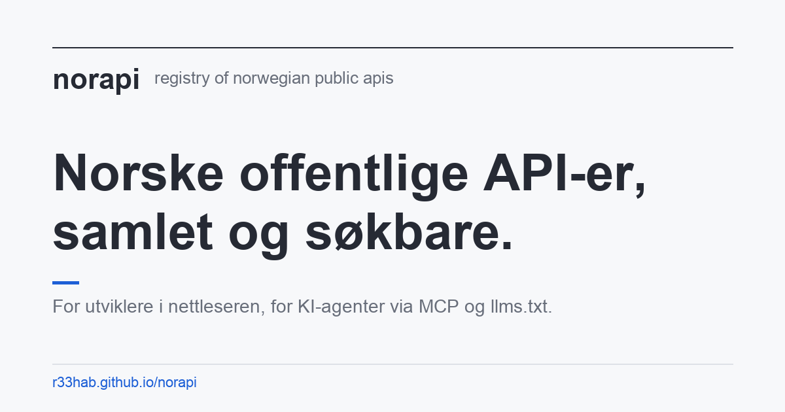
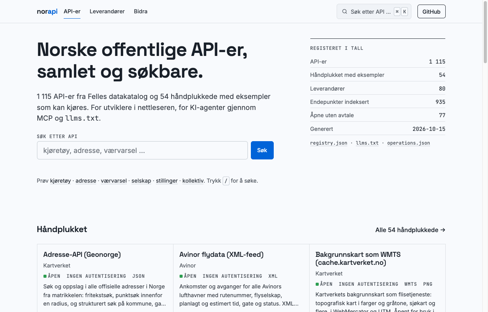

<p align="center">
  <a href="https://r33hab.github.io/norapi/"></a>
</p>

<h1 align="center">norapi</h1>

<p align="center">
  Søkbart register over norske offentlige API-er, for utviklere og KI-agenter.<br>
  <sub>A searchable registry of Norwegian public APIs, for developers and AI agents.</sub>
</p>

<p align="center">
  <a href="https://r33hab.github.io/norapi/"></a>
  <a href="https://r33hab.github.io/norapi/registry.json"></a>
  <a href="https://r33hab.github.io/norapi/operations.json"></a>
  <a href="https://github.com/r33hAB/norapi/actions/workflows/ci.yml"></a>
  <a href="https://github.com/r33hAB/norapi/actions/workflows/harvest.yml"></a>
  <a href="LICENSE"></a>
</p>

<p align="center">
  <a href="https://r33hab.github.io/norapi/"><b>Søk på nettsiden</b></a> ·
  <a href="https://r33hab.github.io/norapi/llms.txt">llms.txt</a> ·
  <a href="https://r33hab.github.io/norapi/registry.json">registry.json</a> ·
  <a href="https://r33hab.github.io/norapi/bidra/">Bidra</a> ·
  <a href="CONTRIBUTING.md">Contributing</a>
</p>

> **Status: under active development.** Everything described here works and is deployed, but
> the project is days old. Entry ids and the JSON shape may still change, and the curated list
> wants to grow. If you know a Norwegian API that is missing, [suggest it](https://github.com/r33hAB/norapi/issues/new?template=nytt-api.yml).

<p align="center">
  <a href="https://r33hab.github.io/norapi/"></a>
</p>

## Why

Norway's public sector publishes hundreds of APIs, but finding the right one means knowing
which agency owns it, what it is called internally, whether it needs Maskinporten, and where the
documentation moved to. [Felles datakatalog](https://data.norge.no/data-services) holds the
official metadata; it is written for registries, not for someone with a terminal open.

norapi takes that catalogue, adds hand-curated entries for the APIs people actually reach for,
fetches the OpenAPI documents where they exist, and serves the result four ways.

## Four front doors

| | What you get | How |
|---|---|---|
| **Web** | One page per API with access, auth, formats, docs, a first call that works, and the endpoints from its OpenAPI document. Instant search and a ⌘K palette. | [r33hab.github.io/norapi](https://r33hab.github.io/norapi/) |
| **CLI** | The same search locally, plus operation search across every indexed specification. | `uv run norapi search "kjøretøy"` |
| **MCP** | Five tools for an AI assistant: `search_apis`, `search_operations`, `get_api`, `list_providers`, `list_categories`. | `claude mcp add norapi -- uv run --directory norapi norapi-mcp` |
| **llms.txt** | One line per API, ready to paste into a prompt or a system message. | [llms.txt](https://r33hab.github.io/norapi/llms.txt) |

## Quick start

```sh
git clone https://github.com/r33hAB/norapi && cd norapi
uv sync

uv run norapi search "kjøretøy"                        # full text, Norwegian or English
uv run norapi search "weather" --access open --auth none
uv run norapi ops "vegobjekter"                        # endpoints: method + path + summary
uv run norapi show brreg-enhetsregisteret              # everything, including a quick_start call
```

```
brreg-enhetsregisteret
  Enhetsregisteret API  [Brønnøysundregistrene]  (open; auth: none; JSON)
  Oppslag og søk i alle norske enheter og underenheter: organisasjonsnummer, navn, …
  https://data.brreg.no/enhetsregisteret/api/docs/index.html
```

The committed `registry/` files are used as is. To refresh them from the sources:

```sh
uv run norapi harvest                # Felles datakatalog -> data/raw/fdk/ (about 30 seconds)
uv run norapi build                  # curated + harvested (+ cached specs) -> registry/
uv run norapi enrich                 # OpenAPI documents -> specs.json + operations.json
uv run norapi check --curated-only   # probe docs, spec and endpoint URLs, record the verdicts
uv run norapi site --out _site       # the static site
```

A GitHub Actions workflow does the same every Monday and commits the result.

## What is inside

| Source | Entries | Notes |
|---|---|---|
| Felles datakatalog (Digdir) | about 1 060 | Everything agencies have registered as a data service, with endpoints, specs, licences and keywords pulled over SPARQL |
| Curated YAML in `registry/curated/` | 145 | Brønnøysundregistrene, SSB, Entur, MET, Kartverket, Nav, Skatteetaten, Digdir, Altinn, Vegvesen, Norges Bank, Stortinget, NVE, Udir, FHI, Helsedirektoratet, Lovdata, Elhub, Sikt, Tolletaten, Fiskeridirektoratet, Finanstilsynet, Vinmonopolet, Luftfartstilsynet and more, each with access, auth, formats, docs and a `quick_start` that was run before it was committed |
| OpenAPI documents | 119 specs, 1 313 operations | Resolved behind `spec_url` and Swagger UI pages; the Petstore sample that unconfigured Swagger UIs ship is filtered out |

Every curated entry is link-checked (`ok`, `answers`, `missing`) and the verdict is shown on its page.

## How it is built

```
registry/curated/*.yaml ──┐                 registry/registry.json ─┬─▶ norapi search / ops  (CLI)
data.norge.no ─▶ harvest ─┼─▶ norapi build ─▶ registry/llms.txt     ├─▶ norapi-mcp           (AI agents)
OpenAPI docs ──▶ enrich ──┘                 registry/operations.json└─▶ norapi site ─▶ _site/ (web)
```

- **Harvest** reads Felles datakatalog through its search API (the list) and SPARQL endpoint (the fields the list leaves out), joined on the data service URI.
- **Curate** merges hand-written YAML on top: curated fields win, harvested fields fill gaps, matched by catalogue URI or identical endpoint.
- **Enrich** fetches OpenAPI and Swagger documents, including the ones hidden behind a Swagger UI page, and indexes every operation.
- **Build** writes `registry.json` (the product), `llms.txt`, and an SQLite FTS5 index that is rebuilt on demand.
- **Site** pre-renders one page per API, provider and category, with sitemap, canonical and Open Graph tags, JSON-LD and a custom 404.

All outbound fetches go through a guard that only talks to public hosts, pins the resolved address, validates every redirect hop and caps body sizes. Design decisions are in [`docs/adr/`](docs/adr/).

## Entry shape

| Field | Meaning |
|---|---|
| `id` | stable slug, `provider-title` |
| `title`, `title_en`, `summary`, `description` | what the API is; `summary` is one line for search results and models |
| `provider` | name, orgnr, sector (`stat`, `kommune`, `fylke`, `statlig-selskap`, `privat`) |
| `access` | `open`, `restricted`, `non-public`, `unknown` |
| `auth` | `none`, `api-key`, `maskinporten`, `id-porten`, `oauth2`, `unknown` |
| `formats`, `endpoints`, `spec_url`, `docs_url`, `license`, `keywords` | the links and facts you need to start |
| `category`, `tags`, `quick_start`, `probe_url` | curated only; `probe_url` is a call that answers anonymously, used by the link checker |
| `caveats` | curated only; restrictions to respect before relying on the API (terms, undocumented or unstable interface, login for parts of it), shown as «Forbehold» on the site, in `llms.txt` and in MCP results |
| `spec` | OpenAPI summary from `norapi enrich`; the operations themselves are in `operations.json` |
| `source` | `fdk`, `curated` or `curated+fdk`, with the catalogue URI and harvest time |
| `checks` | last link-check verdict per URL |

## Contribute

There are more open Norwegian APIs than this registry knows about. Three ways in:

1. **No code:** [suggest an API](https://github.com/r33hAB/norapi/issues/new?template=nytt-api.yml) or [report a mistake](https://github.com/r33hAB/norapi/issues/new?template=feil-i-oppforing.yml). Every page on the site has a link that pre-fills the form.
2. **A pull request:** add a file in `registry/curated/`, run `uv run norapi build && uv run norapi check --curated-only && uv run pytest -q`, and open the PR. The quality bar is in [CONTRIBUTING.md](CONTRIBUTING.md).
3. **Register it at [data.norge.no](https://data.norge.no/data-services)** if you are the provider; the weekly harvest picks it up from there.

## Layout

```
src/norapi/
  harvest/fdk.py     Felles datakatalog: search API + SPARQL, raw snapshot to data/raw/
  curated.py         registry/curated/*.yaml and the merge rules
  enrich.py          OpenAPI resolution and operation extraction
  netguard.py        public-host guard, address pinning, capped bodies
  build.py           registry.json, llms.txt, FTS5 index
  search.py          ranked search with filters, operation search
  check.py           link checker
  site.py            static site generator
  cli.py / mcp_server.py
registry/            curated YAML, registry.json, llms.txt, specs.json, operations.json
site/assets/         design tokens, stylesheet, client-side search, Open Graph image
tests/               unit tests on recorded fixtures, no network
docs/adr/            decisions
```

## Roadmap

- More curated entries, and English summaries for all of them.
- Harvest Geonorge's kartkatalog directly for richer geodata entries.
- Weekly link checks for every entry, published on the site.
- Semantic search next to FTS5 once the registry outgrows keyword matching.

## Data sources and terms

Harvested metadata comes from Felles datakatalog, operated by Digitaliseringsdirektoratet;
each entry links back to its catalogue page. The registry holds descriptions and links, not the
APIs' data. Every API has its own terms and licence, and the registry only reports what the
catalogue or the curator wrote down. Nothing is scraped from agency websites
([ADR-0001](docs/adr/0001-catalogues-and-curation-not-scraping.md)).

## Licence

Code and curated descriptions: MIT. Harvested metadata: see Felles datakatalog.
